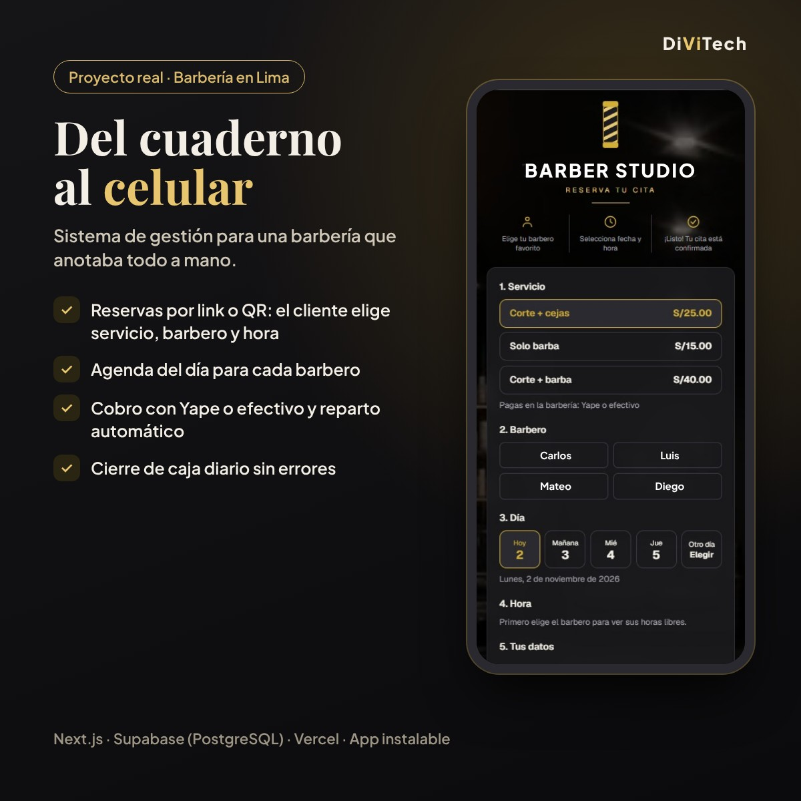

# Sistema de gestión para barbería 💈

App web para que una barbería de Lima deje el **cuaderno** y maneje todo desde el celular: citas, cobros, reparto con los barberos y cierre de caja.

## 🎯 Qué resuelve

La barbería anotaba cada corte a mano y al final del día repartía el dinero con cuentas en papel. Con este sistema:

- **Clientes:** reservan por link o QR eligiendo servicio, barbero, día y hora.
- **Barberos:** ven su agenda del día en el celular y cobran en un solo paso (Yape o efectivo).
- **Dueño:** el reparto con cada barbero se calcula solo, registra los gastos del día y cierra la caja con conteo de efectivo.
- **Control:** cada usuario ve solo lo que le corresponde, y toda anulación queda registrada con su motivo.

## 🛠️ Tecnologías

`Next.js` · `TypeScript` · `Supabase (PostgreSQL)` · `Tailwind CSS` · `PWA (instalable en el celular)` · `Vercel`

## 🔒 Código privado

Este repositorio es solo una presentación. El sistema está en uso en una barbería real, por eso el código es privado y los nombres del negocio y de los barberos se cambiaron por ficticios.
**Demo en vivo y revisión del código disponibles en entrevista.**

---

**Daniel Díaz** · Estudiante de Ingeniería de Sistemas (UCV) · Fundador de **DiViTech**
[LinkedIn](https://www.linkedin.com/in/daniel-diaz-data) · [GitHub](https://github.com/daniel-diaz-v)
